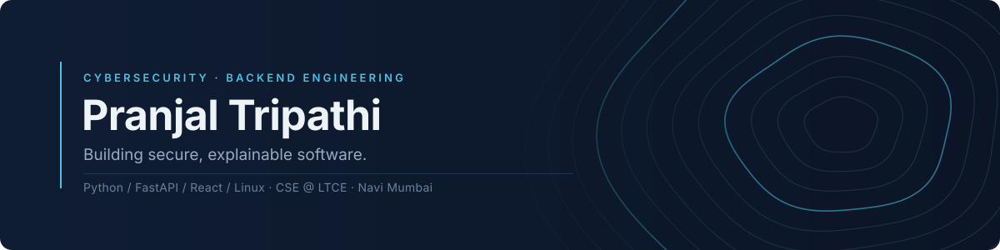

  

  
  
  

## 👋 About me

I'm a computer science student working towards a career in **cybersecurity**. I like building real, working tools, not toy apps. Most of my work sits where **security, backend engineering and AI** meet.

- 🛡️ Working across **core cybersecurity**: network security, threat detection and analysis, digital forensics, and application security
- 🐍 Main language: **Python** (FastAPI and Flask backends, scikit-learn), with **React** on the frontend
- 🌐 Comfortable with **networking fundamentals and reconnaissance**; I work on **Kali Linux**
- 📡 Curious about **wireless networking and radio-frequency engineering**
- 🤖 Exploring **LLM agents and retrieval-augmented generation (RAG)**
- 🎯 Looking for **cybersecurity, backend or AI/ML internships**

## 🚀 Featured projects

<table>
  <tr>
    <td width="50%" valign="top">
      
      <h3>🛡️ AEGIS: Email Threat Forensics</h3>
      
Smart India Hackathon team project. It takes a raw <code>.eml</code> and rebuilds the SMTP relay path, finds the earliest public IP, checks SPF / DKIM / DMARC alignment, flags lookalike domains and deceptive links, and gives an explainable 0–100 risk score with a chain-of-custody log. <b>I worked on the backend</b> and parts of the frontend.

      

        
        
        
        
      

      <a href="https://email-threat-detection-sih.vercel.app"><b>▶ Live demo</b></a> &nbsp;·&nbsp;
      <a href="https://github.com/pranjaltripathi684-wq/email-threat-detection-sih"><b>Code</b></a>
    </td>
    <td width="50%" valign="top">
      
      <h3>🔐 VaultLedger</h3>
      
A private, offline-first personal finance ledger. You type entries in plain English (<i>"lunch 250 yesterday"</i>). It learns categories, detects recurring bills, forecasts month-end spending and handles six currencies. Every entry is <b>chained with SHA-256</b>, so edits made outside the app are detected.

      

        
        
        
        
      

      <a href="https://vaultledger-black.vercel.app"><b>▶ Live demo</b></a> &nbsp;·&nbsp;
      <a href="https://github.com/pranjaltripathi684-wq/VaultLedger"><b>Code</b></a>
    </td>
  </tr>
</table>

> Both demos open in one click with sample data, with no sign-up needed.

## 🧰 Tech stack

**Languages** 

**Backend & data** 

**Frontend** 

**Security & tooling** 

## 🔭 Currently

- 🧠 **Learning:** RAG and LLM agents, and going deeper into network security
- 🛠️ **Building:** a personal agentic OS (a local AI agent runtime for Linux) and a first-person 3D horror game in Three.js
- 🌱 **Next:** contributing to open-source security tools

## 📫 Get in touch

  
  
  

---

<i>Always happy to talk security, backend systems, or a good bug.</i>

